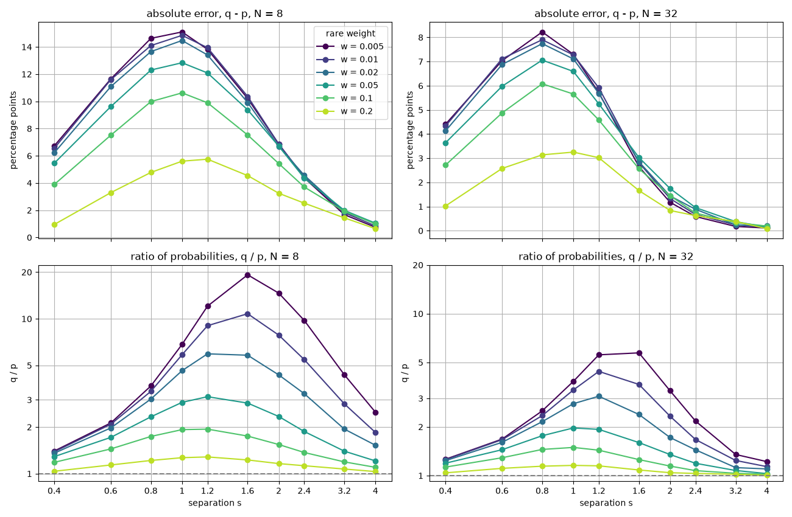
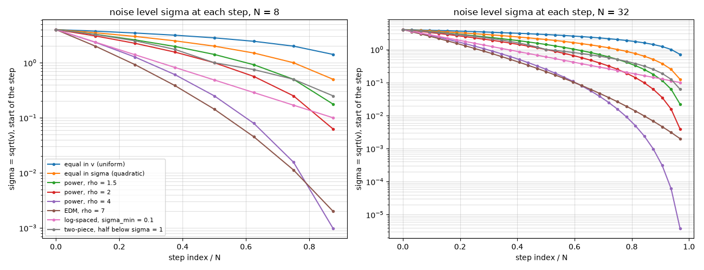
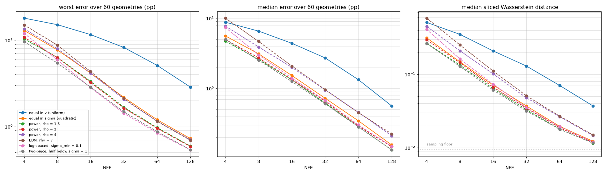
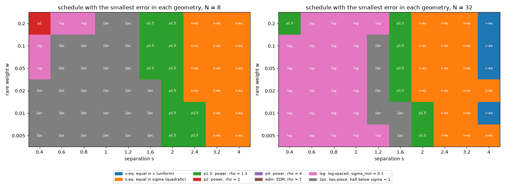

# What breaks the rare-region probability: separation or rarity?

> [!NOTE]
> Regenerate every number and figure here with `PYTHONPATH=src python -m experiments.factor_sweep_experiment`.
> It takes about 10 minutes on a laptop CPU, and a second full run gave a byte-identical `records.json`.
> Results are written to `results/factor_sweep/` and the three figures to `figures/`.

> [!WARNING]
> This uses the exact score, explicit Euler steps, 2D data with $\sigma = 0.35$, and a start at noise variance 16.
> There is no network, so nothing here says how a learned score behaves.
> The grid is new, so no course data file and none of the 18 course cases is read.
> Each cell is one run of 100,000 starting points, so there is no seed-to-seed spread.
> The standard error of one cell is at most 0.14 percentage points (pp), which is small next to the effects below.

## The question

The data is a mixture of three Gaussians.
Two common blobs sit at $(\pm s, 0)$ and one rare blob sits at $(0, s)$ with weight $w$.
A point counts as rare when it lies closer to the rare mean than to the other two means.
Let $p$ be the true probability of that region and $q$ the probability the sampler produces with a budget of $N$ NFE.
The sweep varies four things:

| Factor | Values |
|---|---|
| Separation $s$ | 0.4, 0.6, 0.8, 1.0, 1.2, 1.6, 2.0, 2.4, 3.2, 4.0 |
| Rare weight $w$ | 0.005, 0.01, 0.02, 0.05, 0.1, 0.2 |
| Budget $N$ (NFE) | 4, 8, 16, 32, 64, 128, 256, 512 |
| Step spacing, Figures 1 to 3 | equal in $v$ ("uniform"), or equal in $\sigma = \sqrt{v}$ (the starter's "quadratic") |
| Step spacing, Figures 4 to 6 | six more, listed below, at budgets 4 to 128 |

That is 60 geometries and 3,120 runs, 960 of them for the first two spacings.
Adding the new spacings left all 960 earlier results unchanged.
The target needs no reference sampler, because $p$ has a closed form, where $\Phi$ is the standard normal CDF and $a = s / (\sqrt{2}\,\sigma)$:

$$
p = (1 - w)\,\Phi(a)\,\Phi(-a) + w\,\Phi(a)^2 .
$$

As a check, 2,000,000 clean draws at four geometries matched this formula with z-scores of -2.10, 1.24, 0.85 and -0.44.
The -2.10 is the one borderline value.
Two re-runs at that geometry with other seeds and 8,000,000 draws gave z-scores of -0.04 and -0.48, but those runs were interactive and are not saved.

> [!IMPORTANT]
> The region probability $p$ is not the weight $w$ unless the blobs are far apart.
> For $s \ge 2.0$ the two agree to two decimals.
> At $s = 1.0$ and $w = 0.005$ the region has $p = 2.6\%$, and at $s = 0.4$ it has $p \ge 16.8\%$ whatever $w$ is.
> So at small separation the "rare" blob is not a rare event, and the weight axis measures rarity only for large $s$.

Errors are reported two ways.
The absolute error is $q - p$ in pp.
The relative error is $(q - p)/p$, which I also quote as the ratio $q / p$.

## Short answer

- **Separation sets how large the absolute error gets.** With 8 NFE the error reaches 15.1 pp at $s = 1.0$, and it is 12 pp or more for $0.8 \le s \le 1.2$ whenever $w \le 0.05$. It is not worst at the smallest separation. It falls again below $s \approx 0.8$ to $1.0$ and is about 1 pp or less by $s = 4$.
- **Rarity barely changes the absolute error until $w$ is large.** At $s = 1.0$ with 8 NFE, going from $w = 0.005$ to $w = 0.05$ moves the error from 15.1 to 12.8 pp, while $p$ grows 2.6-fold, from 2.6% to 6.8%.
- **Rarity matters a lot for the ratio $q/p$.** The absolute error is nearly flat in $w$ while $p$ shrinks with $w$, so the sampler's rate becomes many times the true rate. With 8 NFE the ratio is 19.2 at $w = 0.005$ and $s = 1.6$, and never exceeds 1.28 at $w = 0.2$.
- **Step spacing helps more than a moderate increase in the budget.** The worst error over the 60 geometries is 2.2 pp with equal spacing in $\sigma$ at 32 NFE, against 2.9 pp with equal spacing in $v$ at 128 NFE. At 128 NFE with equal spacing in $\sigma$, no geometry has an error above 1 pp, while 29 do with equal spacing in $v$.
- **The shape of the schedule matters beyond that, but less.** Six more schedules (Figures 4 to 6) lower the worst error at 32 NFE from 2.2 pp to between 1.4 and 2.1 pp. The best single choice depends on the separation, with small separations favoring more steps at low noise. Every one of them is far better than equal spacing in $v$, which has a worst error of 8.2 pp at 32 NFE.

## Figure 1: where the error is large

Both panels use 8 NFE and equal spacing in $v$.
The left panel shows $q - p$ in pp, and the right panel shows $(q - p)/p$ in percent on a log color scale.
In the left panel the large values form a band at $0.8 \le s \le 1.2$ that looks the same in every row with $w \le 0.05$.
The rows $w = 0.1$ and $w = 0.2$ are lower, and the band shifts toward $s = 1.2$ for $w = 0.2$.
In the right panel the large values sit at the bottom, in the rows with the smallest $w$, and at larger $s$ than in the left panel.
The two panels disagree about "where it breaks", and the reason is that they use different yardsticks.

## Figure 2: the shape in separation

The top row shows $q - p$ and the bottom row shows $q / p$ on a log axis, for 8 NFE on the left and 32 NFE on the right.
Each line is one weight.
In the top row the lines for $w \le 0.05$ lie almost on top of each other.
At 8 NFE they rise from about 6 pp at $s = 0.4$ to a peak of 12.8 to 15.1 pp at $s = 1.0$, then fall to about 1 pp at $s = 4$.
At 32 NFE the peak is lower and moves left, to $s = 0.8$ with 6.1 to 8.2 pp for $w \le 0.1$, and the tail is below 0.4 pp for $s \ge 3.2$.
In the bottom row the lines fan out.
The peak of the ratio moves to larger $s$ as $w$ falls, from $s = 1.2$ at $w \ge 0.02$ to $s = 1.6$ at $w \le 0.01$ with 8 NFE.
For the course geometry $w = 0.02$ with 8 NFE, the error is 13.7 pp at $s = 0.8$, 6.7 pp at $s = 2.0$, and 4.6 pp at $s = 2.4$.
So the course cases at $s = 0.8$ sit near the worst point, and the cases at larger separation sit on the descending side, where the error is smaller, for example 6.7 pp at $s = 2.0$.

## Figure 3: how many NFE is enough

For each geometry the figure shows the smallest tested budget from which $|q - p|$ stays within the 95% margin $1.96\sqrt{p(1-p)/5000}$ for every larger tested budget.
The 5,000 is the number of starting points in the course data files, so this asks when the error is no bigger than the noise of a course-sized estimate.
With equal spacing in $v$, 9 of 60 geometries never reach the margin by 512 NFE.
They are all at $0.6 \le s \le 1.2$ and $w \le 0.02$, the corner where Figure 1 is worst.
Among the 51 that do, the median is 128 NFE and the maximum is 512.
With equal spacing in $\sigma$, every geometry reaches the margin by 128 NFE, with a median of 64.
The margin shrinks as $p$ falls, so this figure mixes how large the error is with how tight the yardstick is.

## Other step schedules

The starter offers two spacings, and they are two points in a larger family.
Every schedule here is a list of noise variances $v_0 = 16 > v_1 > \dots > v_N = 0$, and only where the $N$ steps sit changes.
I tried six more, chosen after a scan on five geometries at 8 and 32 NFE, so they are not an arbitrary list.

| Name | Steps placed at | Note |
|---|---|---|
| `power_1.5`, `power_2`, `power_4` | $v_i = 16\,u_i^{2\rho}$ with $u_i$ equal from 1 to 0 | $\rho = 0.5$ is equal in $v$ and $\rho = 1$ is equal in $\sigma$, so these continue that family |
| `edm_7` | $\sigma_i = (\sigma_{\max}^{1/\rho} + \frac{i}{N-1}(\sigma_{\min}^{1/\rho} - \sigma_{\max}^{1/\rho}))^{\rho}$ with $\rho = 7$, $\sigma_{\min} = 0.002$ | the discretization of Karras et al. (2022), with $\sigma_{\max} = 4$ |
| `geometric` | $\sigma_i$ equally spaced in $\log \sigma$ from 4 down to 0.1, then a last step to 0 | |
| `two_piece` | half the steps equally spaced in $\sigma$ from 4 to 1, half from 1 to 0 | |

All three of these `power`, `geometric` and `two_piece` families are my own parameterizations, so treat the names as labels for this note and not as methods from the literature.
Every grid starts at $v = 16$, ends at 0, and decreases at each step, and the code asserts this for every schedule and budget.
Besides the rare-region error, I report the sliced Wasserstein distance between the sampler's output and exact draws, using 32 random projections of 20,000 points.
It is a check that a schedule is not fixing the rare region at the cost of everything else, which the project brief asks for.
Between two exact draws it is 0.009 (median over geometries), so values near that mean no visible distortion.

## Figure 4: where the steps go

The left panel shows 8 steps and the right shows 32, with the noise level $\sigma$ at the start of each step on a log axis.
With 8 steps, equal spacing in $v$ takes its last step from $\sigma = 1.41$ straight to 0, and none of its steps starts below $\sigma = 1$.
Equal spacing in $\sigma$ has one such step, the powers 1.5 and 2 and the two-piece schedule have three, and the log-spaced and $\rho = 4$ schedules have five.
`edm_7` has six, so it places the most steps at small $\sigma$, and the first of its steps is already coarse (Figure 5).

## Figure 5: which schedule wins, and by how much

The left and middle panels show the worst and the median absolute error over the 60 geometries, and the right panel shows the median sliced Wasserstein distance.
Solid lines are the two starter spacings and dashed lines are the six new ones.
With 8 NFE the worst error falls from 15.1 pp for equal spacing in $v$ to 7.7 pp for equal spacing in $\sigma$, and to between 5.4 and 6.3 pp for `two_piece`, `geometric`, `power_1.5` and `power_2`.
With 32 NFE the worst error is 8.2 pp for equal spacing in $v$, 2.2 pp for equal spacing in $\sigma$, and 1.4 to 1.7 pp for `two_piece`, `geometric`, `power_2` and `power_1.5`.
At 128 NFE every schedule except equal spacing in $v$ has no geometry above 1 pp.
The two that do worst of the new ones are `power_4` and `edm_7`, at 8.0 and 8.8 pp at 8 NFE, which is no better than equal spacing in $\sigma$ (7.7 pp).
These are also the two with the most steps at small $\sigma$, so more low-noise steps help up to a point, and past it the remaining steps are too coarse.
That is my reading and I did not test it directly.
The 7 in `edm_7` is the value Karras et al. (2022) chose for images, and here it is worse than $\rho = 1.5$ and $\rho = 2$.

Most of the gain comes from moving off equal spacing in $v$.
Among the other seven schedules the worst errors at 32 NFE span 1.4 to 2.2 pp, and the median errors span 0.60 to 0.96 pp.
That spread is small next to the 8.2 pp of equal spacing in $v$.
The sliced distance follows the same order as the rare-region error.
At 32 NFE it is 0.13 for equal spacing in $v$ and 0.03 to 0.05 for the others, against a floor of 0.009.
So the schedules that fix the rare region do not trade it for distortion elsewhere, but none of them reaches the floor at 32 NFE either.

## Figure 6: the best schedule depends on the geometry

Each cell is colored by the schedule with the smallest absolute error in that geometry.
No single schedule wins everywhere.
At 8 NFE `two_piece` wins 28 of 60 geometries, mostly at separation 1.6 or below, and equal spacing in $\sigma$ wins 16, mostly at separation 2.4 or above.
At 32 NFE `geometric` wins 25, `quadratic` wins 18, and equal spacing in $v$ wins 4, all at separation 4.0, where every schedule is within 0.1 pp of the others.
The pattern is that small separations favor schedules with many steps at low noise, and large separations favor the milder equal spacing in $\sigma$.
Measured against equal spacing in $\sigma$, the winner beats it by more than 2 standard errors of one cell in 38 of 60 geometries at 8 NFE and 32 of 60 at 32 NFE.
In the rest, 22 and 28 geometries respectively, the winner is within noise of it.
The winners at neighboring cells differ in ways that look like noise, for example `two_piece` against `geometric` at 32 NFE, so read the colored regions and not individual cells.

Choosing the best schedule geometry by geometry would need to know the geometry.
A single schedule loses little against that oracle at 32 NFE, with `two_piece` at 0.07 pp on average and 0.18 pp at worst, and `geometric` at 0.11 pp on average and 0.38 pp at worst.
Equal spacing in $\sigma$ loses 0.28 pp on average and 0.84 pp at worst, and equal spacing in $v$ loses 2.56 pp and 6.89 pp.

## What the schedules show

- **The last steps are where the error is made.** With equal spacing in $v$ the peak of the absolute error sits at separation 1.0 for 4 to 8 NFE and at 0.8 for 16 to 256 NFE, and it does not keep moving as $N$ grows. Every other schedule lowers the worst error by 6.1 to 6.8 pp at 32 NFE and by 6.4 to 9.7 pp at 8 NFE.
- **The exact schedule matters less than leaving equal spacing in $v$.** At 32 NFE `power_1.5`, `power_2`, `geometric` and `two_piece` all have a worst error of 1.4 to 1.7 pp, against 2.2 pp for equal spacing in $\sigma$ and 8.2 pp for equal spacing in $v$. I did not test whether a tuned schedule would do better still.
- **One failure that is not noise.** The most negative signed error over all geometries and schedules is -0.38 pp, for `geometric` at 8 NFE, so no schedule here makes the sampler under-produce the rare region by more than 0.4 pp.
- **Rare-region error and sliced distance mostly agree.** Across the eight schedules in one geometry, their ranks have a median Spearman correlation of 0.81 at 4 NFE and 0.69 at 32 NFE. The schedule with the smaller sliced distance is the one with the smaller rare-region error in only 10% of geometries at 32 NFE, because several schedules are nearly tied there.
- **Limits.** The scan that chose the schedules used five geometries and a different random seed from the sweep. The NFE counts are for one Euler step per evaluation, so a second-order solver would change the table. A learned score is again not tested.

## Which factor?

One summary is the share of the variation in the error, across all cells, that one factor explains on its own (a main effect).
The three shares do not add to one, because the remainder is interaction between factors.
The shares move a lot when the grid is restricted, so I report four slices at 8 NFE.

| Grid used | $q - p$: separation | weight | spacing | $\log(q/p)$: separation | weight | spacing |
|---|---|---|---|---|---|---|
| Full grid | 0.54 | 0.11 | 0.20 | 0.27 | 0.48 | 0.07 |
| $0.8 \le s \le 2.4$ | 0.37 | 0.15 | 0.36 | 0.06 | 0.73 | 0.11 |
| $w \le 0.05$ | 0.66 | 0.00 | 0.25 | 0.51 | 0.23 | 0.12 |
| Both restrictions | 0.48 | 0.00 | 0.46 | 0.17 | 0.47 | 0.26 |

For the absolute error, separation comes first or ties with spacing, and weight comes last in all four slices.
At 32 NFE the order is separation, then spacing, then weight in all four.
For the ratio, weight leads in three of the four slices and separation leads only when $w \le 0.05$.
So the answer to "which factor" depends on the yardstick, and I do not give one number for it.

## What this does and does not show

- **Shown.** In this controlled setting, separation sets the size of the absolute error and has a peak near $s = 0.8$ to $1.2$, which is 2.3 to 3.4 standard deviations of a blob. Weight sets how large that error looks relative to the true rate. Over $0.8 \le s \le 2.4$, step spacing explains about as much of the absolute error as separation does, with shares of 0.36 and 0.37 at 8 NFE. That share compares only equal spacing in $v$ with equal spacing in $\sigma$, and the other schedules were not part of it.
- **Corrects `figures/README.md`.** It says the error grows as the blobs overlap and barely depends on the rare weight. The first holds only down to about $s = 0.8$ to $1.0$, and below that the error falls. The second holds for the absolute error when $w \le 0.05$, but not for the ratio $q/p$ and not at $w \ge 0.1$.
- **Not tested: why the error is flat in $w$.** One guess is that most false positives come from the two common blobs crossing the boundary of the rare region, which would make $w$ irrelevant. The sweep does not record where false positives start, so this is a guess.
- **Not tested: why the error falls again at small $s$.**
- **Not tested: a learned score.** A network could shift the whole picture, and this is the part the project brief asks to check next.
- **Not tested: other solvers.** All schedules use one Euler step per evaluation.
- **Limits of the numbers.** The shares depend on the range of the grid, the budget map depends on the 5,000-sample yardstick, and each cell is a single run.
