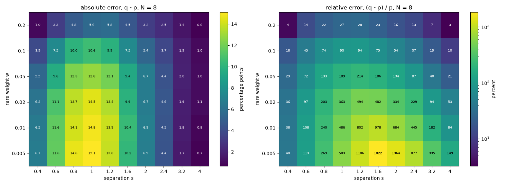
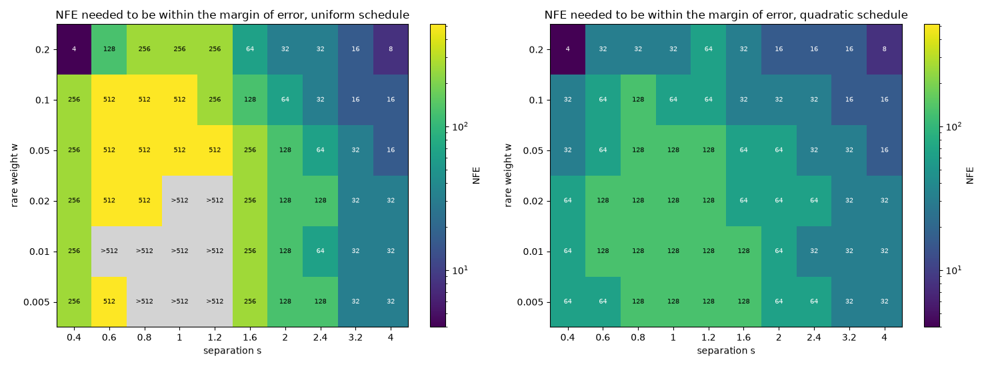

# What breaks the rare-region probability: separation or rarity?

> [!NOTE]
> Regenerate every number and figure here with `PYTHONPATH=src python -m experiments.factor_sweep_experiment`.
> It takes about 4.5 minutes on a laptop CPU, and a second full run gave a byte-identical `records.json`.
> Results are written to `results/factor_sweep/` and the three figures to `figures/`.

> [!WARNING]
> This uses the exact score, explicit Euler steps, 2D data with $\sigma = 0.35$, and a start at noise variance 16.
> There is no network, so nothing here says how a learned score behaves.
> The grid is new, so no course data file and none of the 18 course cases is read.
> Each cell is one run of 100,000 starting points, so there is no seed-to-seed spread.
> The standard error of one cell is at most 0.14 percentage points (pp), which is small next to the effects below.

## The question

The data is a mixture of three Gaussians.
Two common blobs sit at $(\pm s, 0)$ and one rare blob sits at $(0, s)$ with weight $w$.
A point counts as rare when it lies closer to the rare mean than to the other two means.
Let $p$ be the true probability of that region and $q$ the probability the sampler produces with a budget of $N$ NFE.
The sweep varies four things:

| Factor | Values |
|---|---|
| Separation $s$ | 0.4, 0.6, 0.8, 1.0, 1.2, 1.6, 2.0, 2.4, 3.2, 4.0 |
| Rare weight $w$ | 0.005, 0.01, 0.02, 0.05, 0.1, 0.2 |
| Budget $N$ (NFE) | 4, 8, 16, 32, 64, 128, 256, 512 |
| Step spacing | equal in $v$ ("uniform"), or equal in $\sigma = \sqrt{v}$ (the starter's "quadratic") |

That is 60 geometries and 960 runs.
The target needs no reference sampler, because $p$ has a closed form, where $\Phi$ is the standard normal CDF and $a = s / (\sqrt{2}\,\sigma)$:

$$
p = (1 - w)\,\Phi(a)\,\Phi(-a) + w\,\Phi(a)^2 .
$$

As a check, 2,000,000 clean draws at four geometries matched this formula with z-scores of -2.10, 1.24, 0.85 and -0.44.
The -2.10 is the one borderline value.
Two re-runs at that geometry with other seeds and 8,000,000 draws gave z-scores of -0.04 and -0.48, but those runs were interactive and are not saved.

> [!IMPORTANT]
> The region probability $p$ is not the weight $w$ unless the blobs are far apart.
> For $s \ge 2.0$ the two agree to two decimals.
> At $s = 1.0$ and $w = 0.005$ the region has $p = 2.6\%$, and at $s = 0.4$ it has $p \ge 16.8\%$ whatever $w$ is.
> So at small separation the "rare" blob is not a rare event, and the weight axis measures rarity only for large $s$.

Errors are reported two ways.
The absolute error is $q - p$ in pp.
The relative error is $(q - p)/p$, which I also quote as the ratio $q / p$.

## Short answer

- **Separation sets how large the absolute error gets.** With 8 NFE the error reaches 15.1 pp at $s = 1.0$, and it is 12 pp or more for $0.8 \le s \le 1.2$ whenever $w \le 0.05$. It is not worst at the smallest separation. It falls again below $s \approx 0.8$ to $1.0$ and is about 1 pp or less by $s = 4$.
- **Rarity barely changes the absolute error until $w$ is large.** At $s = 1.0$ with 8 NFE, going from $w = 0.005$ to $w = 0.05$ moves the error from 15.1 to 12.8 pp, while $p$ grows 2.6-fold, from 2.6% to 6.8%.
- **Rarity matters a lot for the ratio $q/p$.** The absolute error is nearly flat in $w$ while $p$ shrinks with $w$, so the sampler's rate becomes many times the true rate. With 8 NFE the ratio is 19.2 at $w = 0.005$ and $s = 1.6$, and never exceeds 1.28 at $w = 0.2$.
- **Step spacing helps more than a moderate increase in the budget.** The worst error over the 60 geometries is 2.2 pp with equal spacing in $\sigma$ at 32 NFE, against 2.9 pp with equal spacing in $v$ at 128 NFE. At 128 NFE with equal spacing in $\sigma$, no geometry has an error above 1 pp, while 29 do with equal spacing in $v$.

## Figure 1: where the error is large

Both panels use 8 NFE and equal spacing in $v$.
The left panel shows $q - p$ in pp, and the right panel shows $(q - p)/p$ in percent on a log color scale.
In the left panel the large values form a band at $0.8 \le s \le 1.2$ that looks the same in every row with $w \le 0.05$.
The rows $w = 0.1$ and $w = 0.2$ are lower, and the band shifts toward $s = 1.2$ for $w = 0.2$.
In the right panel the large values sit at the bottom, in the rows with the smallest $w$, and at larger $s$ than in the left panel.
The two panels disagree about "where it breaks", and the reason is that they use different yardsticks.

## Figure 2: the shape in separation

The top row shows $q - p$ and the bottom row shows $q / p$ on a log axis, for 8 NFE on the left and 32 NFE on the right.
Each line is one weight.
In the top row the lines for $w \le 0.05$ lie almost on top of each other.
At 8 NFE they rise from about 6 pp at $s = 0.4$ to a peak of 12.8 to 15.1 pp at $s = 1.0$, then fall to about 1 pp at $s = 4$.
At 32 NFE the peak is lower and moves left, to $s = 0.8$ with 6.1 to 8.2 pp for $w \le 0.1$, and the tail is below 0.4 pp for $s \ge 3.2$.
In the bottom row the lines fan out.
The peak of the ratio moves to larger $s$ as $w$ falls, from $s = 1.2$ at $w \ge 0.02$ to $s = 1.6$ at $w \le 0.01$ with 8 NFE.
For the course geometry $w = 0.02$ with 8 NFE, the error is 13.7 pp at $s = 0.8$, 6.7 pp at $s = 2.0$, and 4.6 pp at $s = 2.4$.
So the course cases at $s = 0.8$ sit near the worst point, and the cases at larger separation sit on the descending side, where the error is smaller, for example 6.7 pp at $s = 2.0$.

## Figure 3: how many NFE is enough

For each geometry the figure shows the smallest tested budget from which $|q - p|$ stays within the 95% margin $1.96\sqrt{p(1-p)/5000}$ for every larger tested budget.
The 5,000 is the number of starting points in the course data files, so this asks when the error is no bigger than the noise of a course-sized estimate.
With equal spacing in $v$, 9 of 60 geometries never reach the margin by 512 NFE.
They are all at $0.6 \le s \le 1.2$ and $w \le 0.02$, the corner where Figure 1 is worst.
Among the 51 that do, the median is 128 NFE and the maximum is 512.
With equal spacing in $\sigma$, every geometry reaches the margin by 128 NFE, with a median of 64.
The margin shrinks as $p$ falls, so this figure mixes how large the error is with how tight the yardstick is.

## Which factor?

One summary is the share of the variation in the error, across all cells, that one factor explains on its own (a main effect).
The three shares do not add to one, because the remainder is interaction between factors.
The shares move a lot when the grid is restricted, so I report four slices at 8 NFE.

| Grid used | $q - p$: separation | weight | spacing | $\log(q/p)$: separation | weight | spacing |
|---|---|---|---|---|---|---|
| Full grid | 0.54 | 0.11 | 0.20 | 0.27 | 0.48 | 0.07 |
| $0.8 \le s \le 2.4$ | 0.37 | 0.15 | 0.36 | 0.06 | 0.73 | 0.11 |
| $w \le 0.05$ | 0.66 | 0.00 | 0.25 | 0.51 | 0.23 | 0.12 |
| Both restrictions | 0.48 | 0.00 | 0.46 | 0.17 | 0.47 | 0.26 |

For the absolute error, separation comes first or ties with spacing, and weight comes last in all four slices.
At 32 NFE the order is separation, then spacing, then weight in all four.
For the ratio, weight leads in three of the four slices and separation leads only when $w \le 0.05$.
So the answer to "which factor" depends on the yardstick, and I do not give one number for it.

## What this does and does not show

- **Shown.** In this controlled setting, separation sets the size of the absolute error and has a peak near $s = 0.8$ to $1.2$, which is 2.3 to 3.4 standard deviations of a blob. Weight sets how large that error looks relative to the true rate. Over $0.8 \le s \le 2.4$, step spacing explains about as much of the absolute error as separation does, with shares of 0.36 and 0.37 at 8 NFE.
- **Corrects `figures/README.md`.** It says the error grows as the blobs overlap and barely depends on the rare weight. The first holds only down to about $s = 0.8$ to $1.0$, and below that the error falls. The second holds for the absolute error when $w \le 0.05$, but not for the ratio $q/p$ and not at $w \ge 0.1$.
- **Not tested: why the error is flat in $w$.** One guess is that most false positives come from the two common blobs crossing the boundary of the rare region, which would make $w$ irrelevant. The sweep does not record where false positives start, so this is a guess.
- **Not tested: why the error falls again at small $s$.**
- **Not tested: a learned score.** A network could shift the whole picture, and this is the part the project brief asks to check next.
- **Limits of the numbers.** The shares depend on the range of the grid, the budget map depends on the 5,000-sample yardstick, and each cell is a single run.
