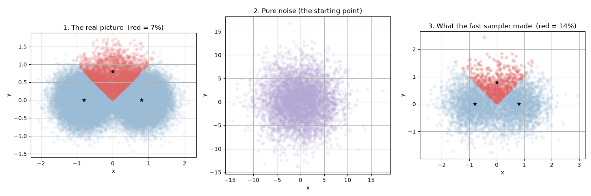
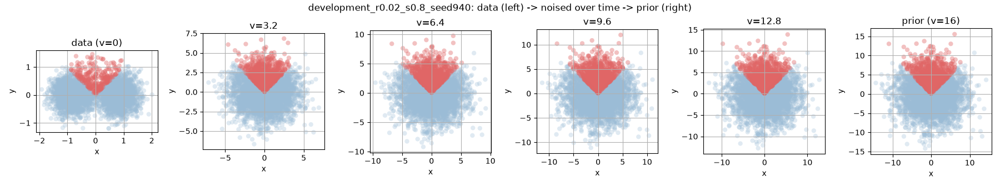
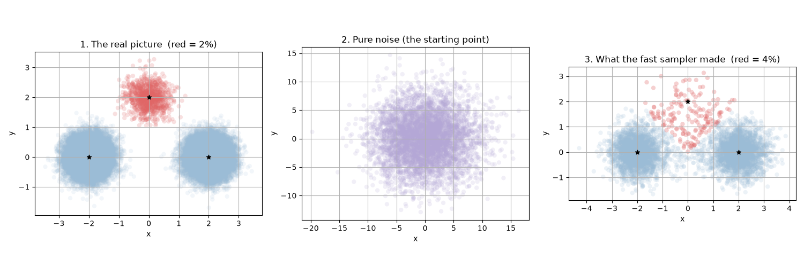
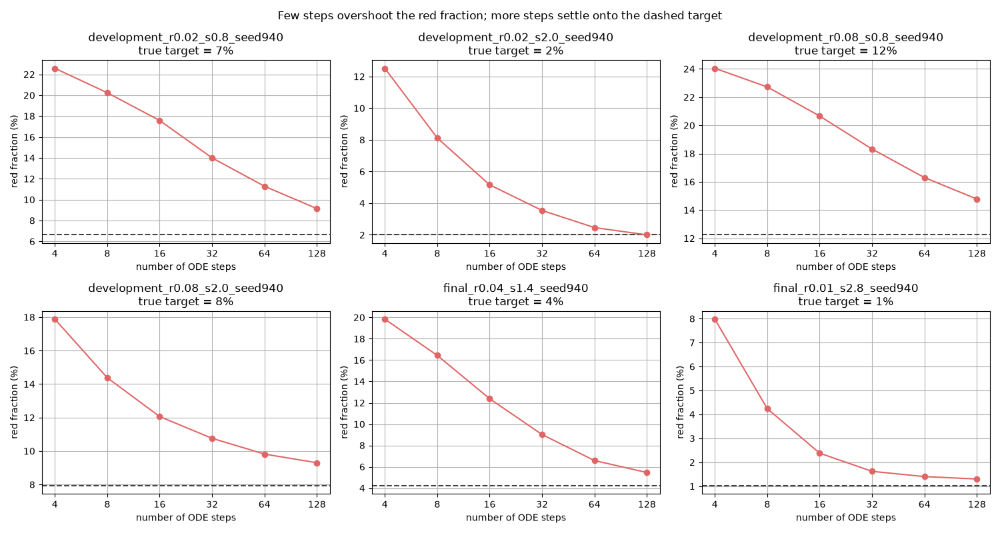
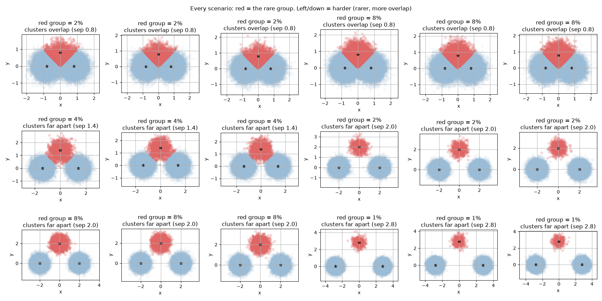

# Reading the figures

This is a guide to every picture in this folder and the idea behind the whole
project. The math you need is calculus, a bit of probability, and a first course
in differential equations. Whenever something technical shows up, there's a plain
version right next to it.

If you only read one paragraph, read this one. We built a fake world where we know
the exact right answer. We then run a cheap shortcut that is supposed to recreate
that world, and we watch it get one specific thing wrong: how often a rare kind of
point shows up. The cheaper the shortcut, the more it overshoots. How badly it
overshoots turns out to depend on the shape of the data, not on how rare the rare
thing is.

---

## 1. What the data looks like

Every scenario is a cloud of points in a 2D plane. The points come from three
round Gaussian blobs.

A Gaussian blob is just a fuzzy dot. Pick a center, then scatter points around it,
most landing near the center and fewer landing far away. The width of that scatter
is the standard deviation $\sigma$. Here every blob has $\sigma = 0.35$, so each
blob is about that wide.

There are three blobs, with centers (we call them means) $\mu_1, \mu_2, \mu_3$. In
every scenario they sit at

$$\mu_1 = (-s, 0), \qquad \mu_2 = (+s, 0), \qquad \mu_3 = (0, s),$$

where $s$ is the separation. Two blobs on the x-axis, one up top. In the figures
the three means are the black stars.

Each blob also has a weight $w_k$, which is how often a point comes from that blob.
The weights add to 1. Two of them are large and one is tiny:

$$w_1 = w_2 \approx 0.49, \qquad w_3 = 0.02 \text{ (or as low as } 0.01).$$

So if you drew 100 points, about 49 would come from the left blob, 49 from the
right blob, and only 2 from the top blob. That top blob is the rare one. It's drawn
in red everywhere in this folder. The two common blobs are blue.

Written as a formula, the data distribution is

$$p_0(x) = \sum_{k=1}^{3} w_k \, \mathcal{N}(x;\mu_k,\,\sigma^2 I), \qquad \sigma = 0.35.$$

In words: to make one data point, first flip a weighted coin to pick a blob (red
only 2% of the time), then draw a fuzzy dot around that blob's center. That's the
whole data generator, and it lives in `generate_data.py`.

Why go to the trouble of fake data? Because we want to catch a sampler making
mistakes, and we can only call something a mistake if we know the truth. A real
image model has two problems tangled together: it might have learned the wrong
distribution, and the procedure for drawing samples from it might be sloppy. When a
sample looks bad you can't tell which problem caused it. Here we delete the first
problem by hand. We picked $p_0$ ourselves, we can write it on paper, so it is
exactly right by construction. Anything that goes wrong in the figures is the
sampler's fault and nobody else's. That is the entire reason the data looks like a
toy.

---

## 2. How "rare" is measured, and why there are straight lines

This is the part that confuses people, so here it is slowly.

Look at panel 1 of a three-panel figure:



See the red region. It's a V-shaped wedge with straight edges, and the red points
are the ones inside it. You might expect "red" to mean "this point actually came
from the rare blob." It does not. Here's the problem. When the sampler hands us a
point, that point has no sticker on it saying which blob made it. We genuinely
cannot tell. The blob labels are hidden.

So we measure something we can see with our own eyes instead: which center is the
point closest to? If the nearest black star is the top one, $\mu_3$, we call the
point red. If the nearest star is one of the bottom two, we call it blue. That's
the only rule.

$$\text{point is red} \iff \arg\min_k \lVert x - \mu_k\rVert^2 = 3.$$

Now the straight lines. The boundary between "closest to the top star" and
"closest to a bottom star" is the set of points that are exactly tied, the same
distance from both. For two points in a plane, the set of places equidistant from
both is a straight line, the perpendicular bisector of the segment joining them.
Three stars give you three such lines, and they chop the plane into three regions.
Those regions are called Voronoi cells, and the red wedge is the Voronoi cell of
the top star. The straight red/blue edges are just "you crossed the halfway line,
now a different star is nearer." Nothing is curved because distance-to-a-point
gives you straight dividing lines.

Here is the subtle fact that the whole project leans on:

$$\Pr[\text{nearest mean is } \mu_3] \;\neq\; w_3.$$

The fraction of points landing in the red wedge is **not** the same as the rare
weight $w_3$. Watch panel 1 again in the overlap case. The blobs are fat ($\sigma =
0.35$) and the centers are close ($s = 0.8$), so a lot of points thrown off by the
blue blobs drift upward and land inside the red wedge. Those points came from blue
blobs but we count them red, because red just means "closest to the top star." The
result: the red wedge holds about 7% of the points even though the rare blob's
weight is only 2%. The crowding from the neighbors inflates the count.

When the blobs sit far apart, this stops happening. A blue point almost never
wanders all the way across to the top star's territory, so the red fraction drops
back down close to $w_3$. In the $s=2.0$ scenario the red fraction is 2.0% and $w_3$
is also 2%. They line up only because the blobs are far enough apart that the
wedge contains almost nothing but true rare points.

So we never use $w_3$ as the target. We estimate the true red fraction from a big
reference sample of 50,000 points drawn straight from $p_0$. Count how many land in
the wedge, divide by 50,000, and that's the number the sampler is supposed to hit.
The starter reports it as `reference_rare_region_probability`.

A count like "6,631 out of 50,000" is an estimate, not a perfect truth, because it
came from a finite sample. The starter wraps it in a Wilson interval, which is a
range that the true fraction very probably sits inside (95% confidence). Think of
it as the error bar on a percentage. If two numbers' intervals overlap a lot, you
shouldn't claim one is really bigger than the other.

---

## 3. What the starter code actually does, argument by argument

You run the sampler from the command line like this:

```
python starter.py --case development_r0.02_s0.8_seed940 --steps 8 16 32 --schedule uniform --output results.json
```

Here's what each piece means.

- `--case`: which of the 18 scenarios to load. The name encodes the settings:
  `r0.02` is the rare weight (2%), `s0.8` is the separation, `seed940` is the random
  seed that generated that particular cloud. Different seeds give statistically
  identical but not pixel-identical clouds, which is how you check your result
  wasn't a fluke.
- `--steps`: a list of step counts to try, like `8 16 32`. This is the knob at the
  heart of the project, explained in the next section. More steps means a slower,
  more careful sampler. Fewer steps means a faster, rougher one.
- `--schedule`: `uniform` or `quadratic`. Both take the same number of steps, but
  they place those steps differently along the path. Uniform spreads them evenly.
  Quadratic crowds them toward the end, near clean data. It's a fairness test: same
  budget, different spending plan, does spending matter?
- `--output`: the JSON file to write the results into.
- `--quick`: a shortcut that just runs steps `8 16` for a fast sanity check.

For each step count the starter runs the sampler and reports, among other things,
the red fraction it produced (`rare_region_probability`), how far that is from the
true target (`rare_region_error`), the Wilson interval on its own count, and two
overall sanity checks on the mean and covariance of the whole cloud. Those last two
matter because a sampler could nail the red fraction by luck while mangling the rest
of the distribution, and you'd want to notice that.

---

## 4. The sampler: noise in, data out

Now the sampler itself. The idea behind diffusion is to connect the data to plain
noise by a smooth ramp, then learn to walk back down the ramp.

### Going up the ramp (adding noise)

Take a clean data point $x_0$ and bury it under Gaussian noise of variance $v$:

$$x_v = x_0 + \sqrt{v}\,\varepsilon, \qquad \varepsilon \sim \mathcal{N}(0, I).$$

In words: nudge the point by a random shove whose size grows with $v$. Small $v$ is
a tiny nudge and the point barely moves. Big $v$ is a huge shove and the point ends
up almost anywhere. Do this to the whole dataset and the three crisp blobs swell,
blur, and eventually melt into one big featureless cloud. At $v = 0$ you have the
real data. At $v = 16$ (the top of the ramp, which the code calls the terminal or
prior) the original shape is gone and the cloud is just a wide blur about 4 units
across in each direction, since its spread is $\sqrt{\sigma^2 + v} \approx \sqrt{16}
= 4$.

`process_<case>.png` shows exactly this sweep, left (clean data) to right (pure
noise):



As your eye moves right, two things happen at once. The structure washes out, and
the axis numbers get bigger because the cloud keeps growing.

### Coming down the ramp (the ODE)

Generating a sample runs the ramp backwards. Start at the top ($v = 16$), where
drawing a point is trivial because it's just a big blur, and walk down to $v = 0$,
where you end up with something that looks like real data.

To walk down you need to know, at every point and every noise level, which
direction points toward denser data. That direction is called the score:

$$s(x,v) = \nabla_x \log p_v(x).$$

Picture the noised density as a hilly landscape. The score is an arrow at every
spot pointing straight uphill, toward where the data piles up. The rule for walking
down the ramp is this differential equation:

$$\frac{dx}{dv} = -\tfrac{1}{2}\, s(x,v).$$

Follow those arrows from $v=16$ down to $v=0$ and a point from the big blur slides
into a point that belongs to the real data distribution. The beautiful part: there
is no randomness in the walk. The only dice roll is where you start, up in the
blur. After that the path is completely determined. Two runs from the same starting
point land in the same place.

For our Gaussian mixture the score is a tidy formula, a weighted average of arrows
each aimed at one of the three centers. We never had to learn it. That formula is
the `score()` function in `starter.py`.

---

## 5. What a "fast sampler" means and why it's wrong

On paper, following the ODE lands you exactly on the data. In practice you cannot
follow a curve perfectly. You take a finite number of straight steps, and the
starter uses the simplest step there is, called forward Euler. One step from noise
level $v$ to the next level $v'$ is:

$$x \leftarrow x + (v' - v)\left(-\tfrac{1}{2}\,s(x,v)\right).$$

Read it out loud. Check which way the arrow points where you're standing, then walk
in a straight line in that direction for the whole step, as if the arrow never
changed along the way. But the arrow does change. The true path curves, and your
straight step cuts the corner and lands a little off.

This is where "fast" and "slow" come from. There is no second model and no training.
The same sampler, running the same ODE, just chops the walk into a different number
of steps:

- A **fast sampler** takes few steps (say 4 or 8). Each step is long, so it cuts a
  lot of corners, so it ends up far from the truth. Cheap but rough.
- A **slow sampler** takes many steps (say 64 or 128). Each step is short, so it
  barely cuts any corner, so it lands close to the truth. Expensive but accurate.

That's the entire meaning of the `--steps` argument. When you pass `--steps 8 16
32`, you're asking for three samplers: a fast one, a medium one, and a slower one,
all solving the same ODE with different step sizes.

How big is the error? Your ODE class gives the rule. One Euler step is off by about
$(\Delta v)^2$, and those little misses add up over the whole walk to a total error
of about $\Delta v$. So if you halve the step size (double the steps), you roughly
halve the final error. That's the trade you're buying: pay double the compute, cut
the error in half.

The interesting question is not whether a fast sampler has error. It always does.
The question is **where the error lands**. Does the rare red blob come out too big
or too small, and what controls that? That's what the plots are for.

---

## 6. The experiment and what the plots mean

### The three-panel figure: one scenario up close

`<case>.png` shows one scenario in three panels:


1. The real picture. These are 50,000 reference points drawn straight from $p_0$,
   colored by the nearest-star rule from Section 2. The red % in the title is the
   true target.
2. Pure noise. 5,000 points drawn from the blur at $v = 16$. This is the exact pile
   the sampler starts from. Notice the axis numbers run out to about $\pm 12$,
   because the blur is wide.
3. What the fast sampler made. It took those same 5,000 noise points, ran them down
   the ODE with a small number of steps, and this is where they landed, colored by
   the same nearest-star rule. The red % here is what the sampler produced.

Compare the red % in panel 3 to panel 1. In the overlap scenario the truth is 7%
and the fast sampler reports 14%, so it doubled the rare fraction. The red wedge in
panel 3 is visibly fatter and more crowded than in panel 1. The sampler pushed too
much mass into the rare region.

Now the same rare weight but with the blobs pulled apart:



Here the truth is 2% and the sampler gives about 4%. Still an overshoot, but a much
smaller one, and the wedge barely changes. Same rare weight, same sampler, totally
different error. The only thing that changed is the spacing. That's the first clue
that spacing, not rarity, drives the mistake.

Why does spacing matter so much? Think about those score arrows. Where two blobs
overlap, the arrows near the seam between them swing around sharply over a short
distance, because the "uphill" direction flips as you cross from one blob's turf to
the other's. A long straight Euler step blows right past that sharp turn and
overshoots. Where the blobs are far apart, the arrows in the empty space between
them are calm and nearly constant, so the same long step tracks them just fine. The
geometry sets how sharply the path bends, and the bending sets the error.

### The step-size figure: the main result

`stepsize_all_cases.png` is the clearest single view of the whole project:



Each of the six panels is one scenario. Inside a panel, the red curve shows the red
fraction the sampler produced as you give it more and more steps (4, 8, 16, 32, 64,
128, left to right). The dashed horizontal line is the true target from the
reference sample. The horizontal axis is on a log scale, so each tick doubles the
step count.

How to read it. The red curve always starts high on the left (few steps, big
overshoot) and falls toward the dashed line as you add steps (the overshoot
shrinking, exactly as the $\Delta v$ rule predicts). A perfect sampler would sit
right on the dashed line. The gap between the curve and the dashed line is the
error.

Now compare panels. The separated cases (`s2.0`, and the `s2.8` final case) drop
onto the dashed line fast and basically sit on it by 128 steps. The overlap cases
(`s0.8`) are stubborn. Even at 128 steps the red curve is still floating well above
the line, refusing to come down. Same sampler, same step counts, and the only
difference is how far apart the centers sit.

The numbers behind the curves, red fraction in percent:

| Scenario | True target | 4 steps | 32 steps | 128 steps |
|----------|-------------|---------|----------|-----------|
| `development_r0.02_s0.8` | 6.6 | 22.6 | 14.0 | 9.1 |
| `development_r0.08_s0.8` | 12.2 | 24.0 | 18.3 | 14.8 |
| `development_r0.02_s2.0` | 2.0 | 12.5 | 3.5 | 2.0 |
| `development_r0.08_s2.0` | 7.9 | 17.9 | 10.8 | 9.3 |
| `final_r0.04_s1.4` | 4.2 | 19.8 | 9.0 | 5.5 |
| `final_r0.01_s2.8` | 1.0 | 8.0 | 1.6 | 1.3 |

Read the `s2.0` and `s2.8` rows: by 128 steps the sampler has basically hit the
target. Read the `s0.8` rows: it's still off by nearly a factor of two even at 128
steps. Compare the two `r0.02` rows (same rarity, different spacing) against the
two `s0.8` rows (same spacing, different rarity) and the pattern is plain. Change
the rarity and the error hardly moves. Change the spacing and the error changes a
lot.

### The overview grid: all 18 at once

`overview_all_cases.png` lays out every scenario's true distribution, sorted so the
hard ones (overlapping blobs) are near the top and the easy ones (well-separated
blobs) are toward the bottom right:



Run your eye down the grid and watch the red wedge shrink in tight around the lone
red blob as the blobs separate. At the top, the wedge is bloated with blue points
that wandered in. At the bottom, it hugs the real rare blob. The gap between the
red fraction and the true weight $w_3$ closes at the same pace the blobs pull apart.
That shrinking gap is the whole story in one picture.

---

## 7. The takeaway

Fast sampling makes the rare outcome show up too often. The size of that mistake is
set mostly by how much the blobs overlap, and only a little by how rare the rare
blob is. The mechanism is corner-cutting: Euler's straight steps overshoot wherever
the score field turns sharply, and the field turns sharply exactly where blobs
overlap. Treat every percentage as an estimate with an error bar (the Wilson
interval), not a hard verdict, especially when the numbers are close.

## Rebuilding the figures

From the project root:

```
.venv/bin/python plot_data.py
```

This overwrites every PNG in this folder.
