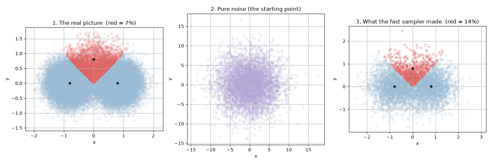
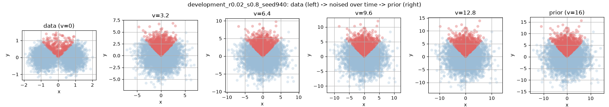
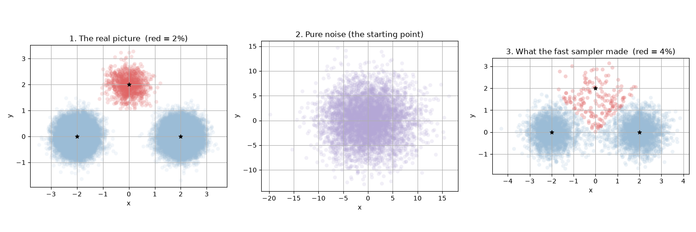
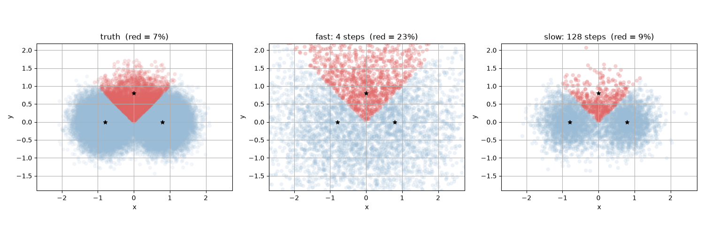
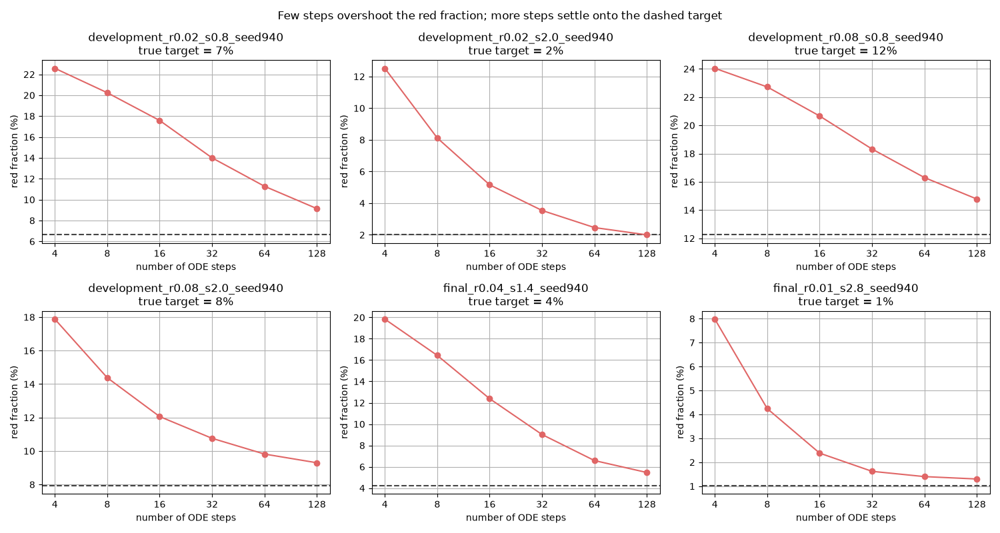
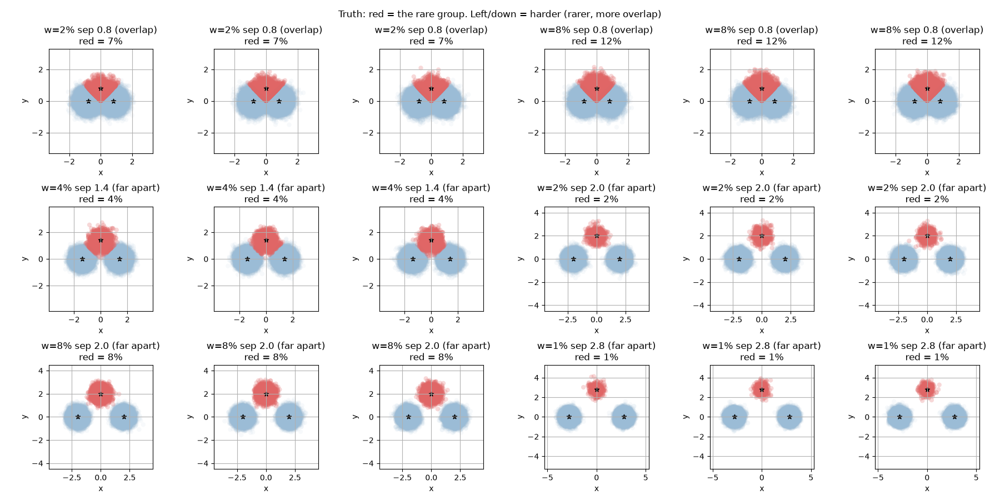

# Reading the figures

This explains the figures in this folder and what the project is doing. You need
calculus, basic probability, and intro ODEs.

The short version: we built fake data where we know the exact right answer, then
ran a cheap sampler that is supposed to reproduce it. The sampler makes the rare
class show up too often, and how badly depends on how much the clusters overlap.

## The data

The synthetic data is a mixture of three Gaussian distributions in 2D. The density
is

$$p_0(x) = \sum_{k=1}^{3} w_k \, \mathcal{N}(x;\mu_k,\,\sigma^2 I), \qquad \sigma = 0.35.$$

The three means are placed like this, where `s` is the separation:

$$\mu_1 = (-s, 0), \qquad \mu_2 = (+s, 0), \qquad \mu_3 = (0, s).$$

Two components are common and one is rare:

$$w_1 = w_2 \approx 0.49, \qquad w_3 = 0.02 \text{ (down to } 0.01).$$

So a point comes from the rare component only about 2% of the time. In every figure
the rare component is red and the two common ones are blue. The code that makes the
data is `draw()` in `generate_data.py`:

```python
def draw(rng,n,means,weights,variance):
    component=rng.choice(len(weights),size=n,p=weights)
    return (means[component]+rng.normal(0,np.sqrt(variance),(n,2))).astype(np.float32)
```

We use fake data because we want to measure sampler error, and you can only call
something an error if you know the truth. Real models have two error sources mixed
together (a wrong learned distribution and a sloppy sampler), and you can't tell
them apart. Here $p_0$ is exact by construction, so every mistake in the figures is
the sampler's.

Contrast with a real diffusion model: there you fit a neural network to data and
never know the true $p_0$, so a bad sample could be the network's fault or the
sampler's. This project cuts the network out entirely. Same ODE, same sampler, but
an exact score instead of a learned one.

## How "rare" is measured

Look at panel 1:



The red region is a V-shaped wedge. A generated point has no label telling us which
component produced it, so we can't count true membership. Instead we label a point
red if its nearest mean is $\mu_3$:

$$\text{red} \iff \arg\min_k \lVert x - \mu_k\rVert^2 = 3.$$

This is the same problem real diffusion models have. A generated image doesn't come
with a label saying "this is the rare class," so people measure rare-class behavior
with a proxy (a classifier, a density estimate, a nearest-neighbor check). Our
nearest-mean rule is the toy version of that proxy.

That's `rare_region()` in `starter.py`:

```python
def rare_region(x,means):
    return np.argmin(((x[:,None,:]-means[None,:,:])**2).sum(axis=2),axis=1)==2
```

The boundary between "closest to $\mu_3$" and "closest to another mean" is where
two distances are equal, which is a straight line (the perpendicular bisector).
Three means give three such lines and split the plane into Voronoi cells. That's
why the red/blue edges are straight.

Important: the red fraction is not the rare weight.

$$\Pr[\text{nearest mean is } \mu_3] \;\neq\; w_3.$$

When the clusters are close (small `s`), points from the blue components spill into
the red wedge, so the red fraction reads higher than $w_3$. In the `s0.8` case the
red fraction is about 7% even though $w_3 = 2\%$. When `s` is large the spill stops
and the red fraction drops back near $w_3$ (in `s2.0` both are 2%).

So we never use $w_3$ as the target. We estimate the true red fraction from the
50,000 reference points and use that. The starter reports it as
`reference_rare_region_probability`, with a Wilson confidence interval
(`wilson()`) as the error bar.

## The starter arguments

You run it like:

```
python starter.py --case development_r0.02_s0.8_seed940 --steps 8 16 32 --schedule uniform --output results.json
```

- `--case`: which scenario. `r0.02` = rare weight, `s0.8` = separation, `seed940` =
  which random cloud. Different seeds are independent clouds with the same settings.
- `--steps`: how many ODE steps the sampler takes. This is the main knob. More steps
  = slower and more accurate.
- `--schedule`: `uniform` or `quadratic`. Same number of steps, placed differently
  along the path. Quadratic puts more steps near clean data.
- `--output`: output JSON file.
- `--quick`: shortcut that runs `--steps 8 16`.

## The sampler

Diffusion connects the data to noise. The forward process takes a clean point and
adds Gaussian noise of variance `v`:

$$x_v = x_0 + \sqrt{v}\,\varepsilon, \qquad \varepsilon \sim \mathcal{N}(0, I).$$

Small `v` barely moves the point; large `v` turns the data into a wide blur. At
`v = 0` you have the data, at `v = 16` (the prior) the structure is gone. The spread
at level `v` is $\sqrt{\sigma^2 + v}$, so at `v = 16` it's about 4 per axis.
`process_<case>.png` shows this sweep, left (data) to right (noise):



This is the variance-exploding setup: we add noise variance directly and let the
spread grow without bound. Real diffusion models like DDPM usually use the
variance-preserving setup, which shrinks the signal while adding noise so the total
variance stays near 1, and they index the process by a time $t \in [0,1]$ instead of
by the noise variance `v`. Same idea (data on one end, noise on the other), different
bookkeeping. We index by `v` because it makes the score formula clean.

Generation runs backward. Start at `v = 16` and integrate down to `v = 0`. The
direction is the score, $s(x,v) = \nabla_x \log p_v(x)$, which points toward denser
data. The sampler follows the probability-flow ODE:

$$\frac{dx}{dv} = -\tfrac{1}{2}\, s(x,v).$$

For a Gaussian mixture the score has a closed form, so we never have to learn it.
That's `score()` in `starter.py`:

```python
def score(x,v,means,weights,base_variance):
    var=base_variance+v
    delta=x[:,None,:]-means[None,:,:]
    logmass=np.log(weights)[None,:]-.5*np.sum(delta**2,axis=-1)/var
    posterior=np.exp(logmass-logsumexp(logmass,axis=1,keepdims=True))
    return -(posterior[:,:,None]*delta).sum(axis=1)/var
```

In a real diffusion model this function is a neural network trained on noisy data,
and it's only approximate. Swapping our exact `score()` for a learned one is exactly
how you'd turn this project into a real diffusion model, and it's the extension the
README describes.

## What "fast sampler" means

There's no second model. The sampler integrates the same ODE, just with a different
number of steps. It uses forward Euler, one step from `v` to `v'`:

$$x \leftarrow x + (v' - v)\left(-\tfrac{1}{2}\,s(x,v)\right).$$

That's the loop in `sample()`:

```python
def sample(terminal,grid,means,weights,base_variance):
    x=np.array(terminal,dtype=float,copy=True)
    for v,next_v in zip(grid[:-1],grid[1:]):
        x+=(next_v-v)*(-.5*score(x,v,means,weights,base_variance))
    return x
```

Each step assumes the score is constant over the whole step. The real path curves,
so a long step overshoots the curve.

- Few steps (4, 8): big $\Delta v$, big overshoot, cheap.
- Many steps (64, 128): small $\Delta v$, small error, expensive.

The Euler error per step is about $(\Delta v)^2$ and the total error is about
$\Delta v$, so halving the step size roughly halves the final error. The question
isn't whether there's error, it's where it goes: does the rare class come out too
big or too small, and what controls it.

This is the same speed/quality tradeoff that matters for real diffusion models. A
real model might need hundreds or thousands of steps for a clean sample, which is
slow, so a lot of work (DDIM, DPM-Solver, consistency models) goes into getting
good samples in 10 to 20 steps. Our plain Euler is the simplest possible solver, so
it shows the raw tradeoff without any of those tricks. Those fast solvers are
basically smarter versions of the `sample()` loop below.

## The three-panel figure


1. True distribution (50,000 reference points, colored by nearest mean). Red % is
   the target.
2. The prior at `v = 16`, the noise the sampler starts from. Axis runs to about
   ±12 because the blur is wide.
3. Sampler output after Euler runs down to `v = 0`. Red % here is what it produced.

In this overlap case the target is 7% and the sampler gives 14%, so it doubles the
rare fraction. Same rare weight but clusters pulled apart:



Here the target is 2% and the sampler gives about 4%. Much smaller error, same
sampler. The only change is the spacing.

Reason: where two clusters overlap, the score arrows near the boundary swing around
fast, so a long Euler step overshoots the turn. Where clusters are far apart the
arrows between them are nearly constant, so the same step tracks them fine. Overlap
sets the curvature, curvature sets the error.

The same thing shows up in real diffusion models as the minority or rare-class
problem: fast samplers tend to miss or distort low-density parts of the
distribution, and whole methods (minority guidance, for example) exist to pull
samples back into those regions. Our figures show the cleanest possible version of
that failure, with the model error removed so only the sampler is to blame.

## Fast sampler vs slow sampler

Same case, same starting noise, same ODE. The only difference is the step count.



Left is the truth (7% red). Middle is the fast sampler at 4 steps (23% red), which
badly overshoots: the red wedge is bloated and the whole cloud is too spread out
because the big Euler steps overshoot everywhere, not just the rare region. Right
is the slow sampler at 128 steps (9% red), which is close to the truth and looks
much more like it. It's generated by `fast_vs_slow_figure()` in `src/plot_data.py`.

This is the fast/slow tradeoff in one picture. The fast sampler is cheap but wrong;
the slow sampler costs 32x more score evaluations and gets most of the error back.
Real diffusion work is mostly about getting the middle panel to look like the right
panel without paying for 128 steps, which is what better solvers (DDIM, DPM-Solver)
do.

## The step-size figure

This is the clearest view of the result.



Each panel is one scenario. The red curve is the red fraction the sampler produces
at 4, 8, 16, 32, 64, 128 steps (x-axis is log scale, base 2). The dashed line is
the true target. A perfect sampler sits on the dashed line; the gap is the error.
It's generated by `stepsize_figure()` in `src/plot_data.py`.

Every curve starts high and falls toward the target as steps increase. Compare
panels: the separated cases (`s2.0`, `s2.8`) land on the target by 128 steps, while
the overlap cases (`s0.8`) are still well above it even at 128 steps.

| Scenario | True target | 4 steps | 32 steps | 128 steps |
|----------|-------------|---------|----------|-----------|
| `development_r0.02_s0.8` | 6.6 | 22.6 | 14.0 | 9.1 |
| `development_r0.08_s0.8` | 12.2 | 24.0 | 18.3 | 14.8 |
| `development_r0.02_s2.0` | 2.0 | 12.5 | 3.5 | 2.0 |
| `development_r0.08_s2.0` | 7.9 | 17.9 | 10.8 | 9.3 |
| `final_r0.04_s1.4` | 4.2 | 19.8 | 9.0 | 5.5 |
| `final_r0.01_s2.8` | 1.0 | 8.0 | 1.6 | 1.3 |

Compare the two `r0.02` rows (same rarity, different spacing) against the two `s0.8`
rows (same spacing, different rarity). Changing rarity barely moves the error.
Changing spacing moves it a lot.

## The overview grid



`overview_all_cases.png` shows all 18 true distributions, sorted so overlapping
cases are at the top and separated ones at the bottom. As the clusters separate, the
red wedge tightens around the rare cluster and the red fraction drops toward $w_3$.

## Takeaway

Fast sampling inflates the rare class. The size of the error depends mostly on
cluster overlap and only weakly on how rare the class is. The mechanism is Euler
overshooting where the score field curves sharply, which happens where clusters
overlap. Treat the percentages as estimates with Wilson intervals, not exact
values.

## Rebuilding the figures

```
.venv/bin/python src/plot_data.py
```

Overwrites every PNG in this folder.
