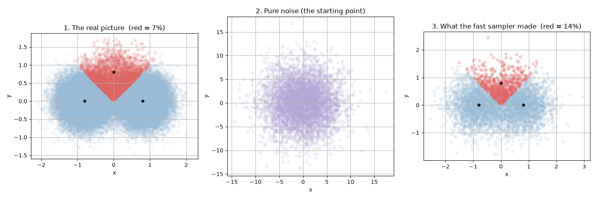
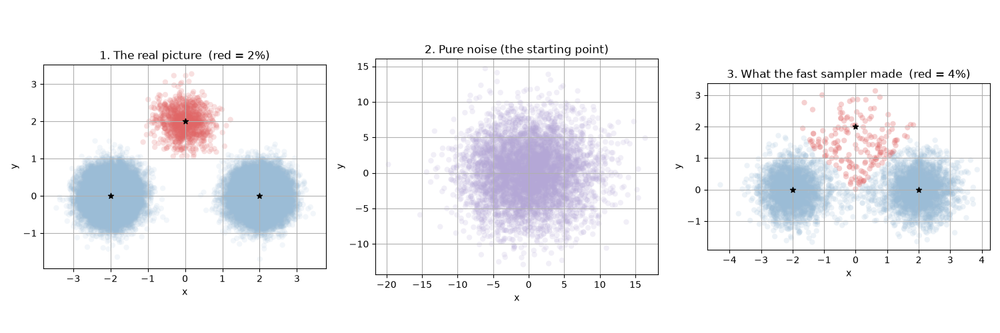
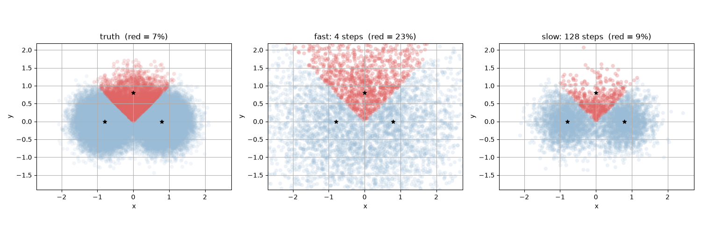
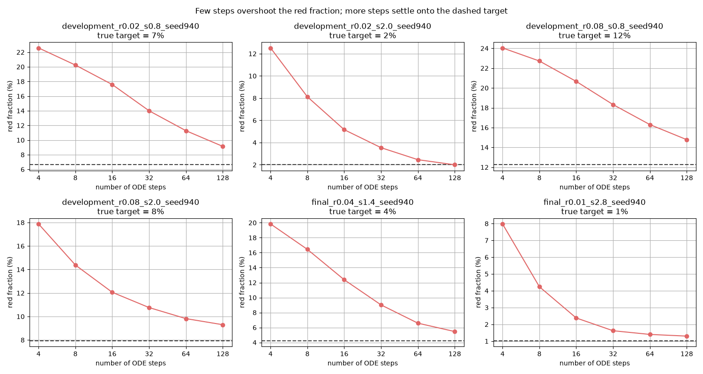
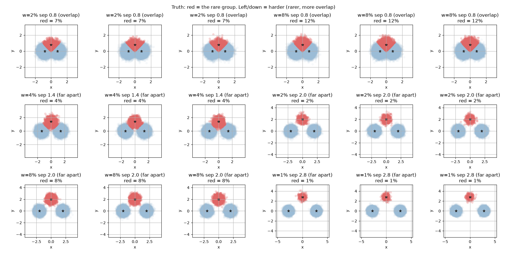
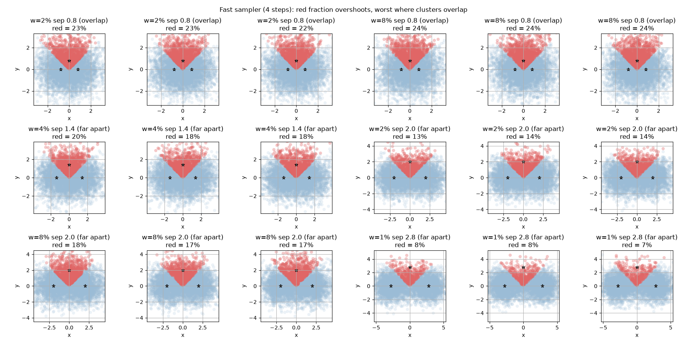
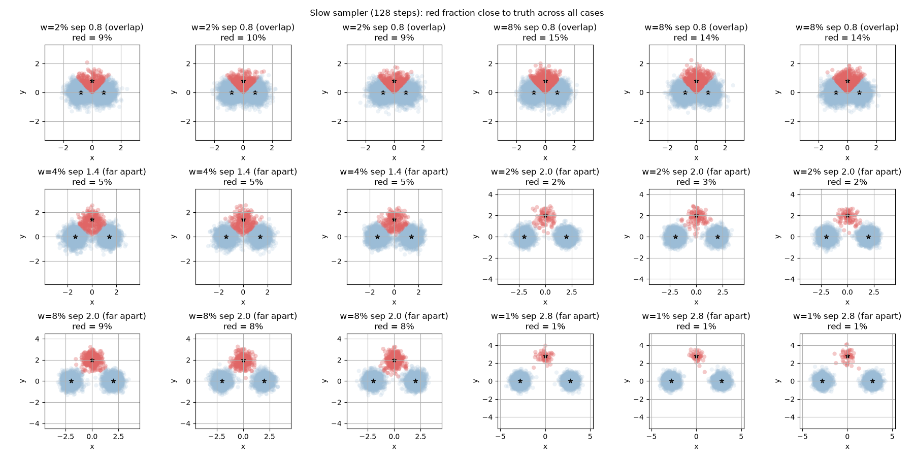

# Notes on the figures

These notes work through what each figure in this folder is actually computing. The
setup is a probability-flow ODE sampler on a Gaussian mixture we wrote down by hand,
so there is no trained network and no model error. Every gap you see between a
sampler and its target is numerical, and that is the point.

> [!NOTE]
> There is no learned model anywhere in these figures. The score is the exact
> closed form for the mixture, so any error is the solver's, not a network's.

## Setting up the target

We fix a mixture of three Gaussians in the plane. Writing $\mathcal{N}(x; \mu, \sigma^2 I)$ for an isotropic Gaussian,

$$
p_0(x) = \sum_{k=1}^{3} w_k\, \mathcal{N}(x; \mu_k, \sigma^2 I), \qquad \sigma = 0.35,
$$

with the means placed at

$$
\mu_1 = (-s, 0), \qquad \mu_2 = (+s, 0), \qquad \mu_3 = (0, s),
$$

and weights $w_1 = w_2 \approx 0.49$, $w_3 \in \{0.01, 0.02, 0.04, 0.08\}$. Component 3 is
the rare one. The scalar $s$ is the separation, and it is the knob that decides how
much the three blobs overlap. Everything downstream is read against this $p_0$, which
we know exactly because we chose it.

The sampling code lives in `src/starter/starter.py` and the plotting code in `src/plot_data.py`.

## The rare event is a region, not a label

A generated point does not come stamped with the component that produced it, so we
cannot measure $w_3$ directly from samples. We measure a region instead: a point
counts as rare when its nearest mean is $\mu_3$. This is the Voronoi cell of $\mu_3$,
and `rare_region` in `src/starter/starter.py` implements it as

$$
\text{rare}(x) \iff \arg\min_k \lVert x - \mu_k \rVert^2 = 3.
$$

The boundary between two cells is the set of points equidistant from two means, which
is a straight line (the perpendicular bisector), so the red region in the figures is a
wedge with straight edges.

Here is the subtlety that trips everyone up the first time. The probability of the
region is not the weight of the component:

$$
\Pr\big[\text{nearest mean is } \mu_3\big] \neq w_3.
$$

> [!WARNING]
> Do not treat the red region fraction as the rare component weight $w_3$. They are
> different numbers, and the gap between them grows as the blobs overlap.

When the blobs overlap, points drawn from the two common components spill into the
cell of $\mu_3$ and get counted as rare. So the region probability sits above $w_3$,
and the gap grows as $s$ shrinks. We never target $w_3$. We estimate the region
probability from the 50,000 reference points and target that, with a Wilson interval
from `wilson()` as the error bar.

> [!IMPORTANT]
> The target is the reference region fraction, not $w_3$. For the overlap case
> ($s = 0.8$, $w_3 = 0.02$) the reference region fraction is about $7\%$, more than
> triple the component weight. For a well-separated case ($s = 2.0$) the spillover is
> gone and the two numbers agree at about $2\%$.

## The sampler is an ODE solved by Euler

Noising a clean point adds Gaussian variance $v$, so $x_v = x_0 + \sqrt{v}\,\varepsilon$, and
the whole dataset at level $v$ is $p_0$ convolved with $\mathcal{N}(0, vI)$. We run from the
prior at $v = 16$ down to $v = 0$ along the probability-flow ODE

$$
\frac{dx}{dv} = -\tfrac{1}{2}\, s(x, v), \qquad s(x, v) = \nabla_x \log p_v(x),
$$

where the score $s(x, v)$ is available in closed form for a Gaussian mixture, computed
by `score()`. No network is trained; this is the clean case where the score is exact.

### The score, worked out

It is worth seeing exactly what `score()` computes, since the closed form is the
whole reason this project can isolate solver error. At level $v$ every component has
its variance inflated by $v$, so writing $\tau^2 = \sigma^2 + v$ (the `var` in the
code) the noised density is a mixture of wider Gaussians,

$$
p_v(x) = \sum_{k=1}^{3} w_k\, \mathcal{N}(x; \mu_k, \tau^2 I).
$$

The score is the gradient of its log, and since $\nabla_x \log p_v = (\nabla_x p_v)/p_v$
we differentiate each Gaussian. For one Gaussian,
$\nabla_x \mathcal{N}(x; \mu_k, \tau^2 I) = \mathcal{N}(x; \mu_k, \tau^2 I)\cdot\big({-}(x - \mu_k)/\tau^2\big)$,
so

$$
s(x, v) = \frac{\sum_k w_k\, \mathcal{N}(x; \mu_k, \tau^2 I)\,\big({-}(x - \mu_k)/\tau^2\big)}
{\sum_j w_j\, \mathcal{N}(x; \mu_j, \tau^2 I)}.
$$

The Gaussian normalizing constants are identical across components (same $\tau^2$), so
they cancel between numerator and denominator. What is left in each ratio is the
posterior weight, or responsibility, that component $k$ takes for the point $x$:

$$
\gamma_k(x) = \frac{w_k \exp\!\big({-}\lVert x - \mu_k \rVert^2 / (2\tau^2)\big)}
{\sum_j w_j \exp\!\big({-}\lVert x - \mu_j \rVert^2 / (2\tau^2)\big)},
\qquad \sum_k \gamma_k(x) = 1.
$$

Putting it together, the score is a responsibility-weighted pull toward every center,

$$
\boxed{\; s(x, v) = -\frac{1}{\sigma^2 + v} \sum_{k=1}^{3} \gamma_k(x)\,(x - \mu_k). \;}
$$

That is exactly the function `score()` evaluates: the `logmass` line builds
$\log w_k - \lVert x - \mu_k\rVert^2 / (2\tau^2)$, the `logsumexp` subtraction turns it
into the responsibilities $\gamma_k$, and the last line forms
$-\sum_k \gamma_k (x - \mu_k)/\tau^2$. Reading the formula: each component pulls $x$
toward its own mean $\mu_k$, the pull is weighted by how plausible that component is
for $x$, and the whole thing is scaled by $1/(\sigma^2 + v)$ so the pull weakens as
the noise $v$ grows. A finite-difference check against $\nabla_x \log p_v$ agrees to
about $2 \times 10^{-10}$, and `src/starter/check_data.py` runs that comparison.

The solver is explicit Euler. One step from $v$ to the next level $v'$ is

$$
x \leftarrow x + (v' - v)\Big(-\tfrac{1}{2}\, s(x, v)\Big),
$$

which assumes the score is constant across the step. It is not, so each step cuts the
corner of the true curve. Standard ODE error accounting gives a local error of order
$(\Delta v)^2$ per step and a global error of order $\Delta v$, so halving the step
size roughly halves the final error.

This is exactly where "fast" and "slow" come from. The number of steps is the only
thing that changes between a fast and a slow sampler; the ODE and the starting noise
are identical. A fast sampler takes a few long steps (big $\Delta v$, large error). A
slow sampler takes many short steps (small $\Delta v$, small error). The schedule
argument (`uniform` vs `quadratic`) decides where along $[0, 16]$ those steps are
placed, at a fixed step count.

## What a real diffusion model changes

A real diffusion model solves the same kind of ODE, but it cannot write $s(x, v)$
down. There is no formula for the score of a photograph distribution, so the model
learns one. You train a network $s_\theta(x, v)$ to approximate the true score by
fitting the denoising objective

$$
\theta^\star = \arg\min_\theta\; \mathbb{E}_{x_0,\, v,\, \varepsilon}
\Big\lVert s_\theta\big(x_0 + \sqrt{v}\,\varepsilon,\, v\big) + \tfrac{\varepsilon}{\sqrt{v}} \Big\rVert^2,
$$

where the target $-\varepsilon / \sqrt{v}$ is the exact score of the Gaussian that
noised $x_0$ into $x_v$. After training you sample with the identical Euler loop,
only swapping our closed-form `score()` for the network:

$$
x \leftarrow x + (v' - v)\Big(-\tfrac{1}{2}\, s_\theta(x, v)\Big).
$$

The loop is the same, the step count still controls the discretization error the same
way, but now the arrow $s_\theta$ is only approximately right. So a real model carries
two error sources at once: the solver error we study here, plus a model error from
$s_\theta \neq s$ that is present even with infinitely many steps.

> [!NOTE]
> This project deletes the model-error term on purpose. Because our `score()` is the
> exact score of a mixture we chose, $s_\theta = s$ and the only thing left to blame
> is the Euler discretization. Swapping in a trained $s_\theta$ is the extension the
> README mentions, and it is what turns this into an ordinary diffusion model.

## The three-panel figure

`<case>.png` shows one scenario in three panels: the true $p_0$ from the reference
sample, the prior at $v = 16$ that the sampler starts from, and the sampler output
after Euler runs down to $v = 0$. The red percentage in the first and third titles is
the region fraction, so the comparison is direct.



For the overlap case the target is $7\%$ and the fast sampler returns $14\%$, so it
doubles the rare mass. Pull the blobs apart and the same sampler behaves:



Here the target is $2\%$ and the sampler returns about $4\%$. Same rare weight, same
solver, much smaller error. The one thing that changed is $s$. The mechanism is the
score field: where blobs overlap, the arrows near the seam turn sharply over a short
distance, and a long Euler step overshoots that turn. Where the blobs are far apart
the field between them is nearly flat and the long step tracks it fine. Overlap sets
the curvature and the curvature sets the error, so $s$ matters far more than $w_3$.

## Fast versus slow, side by side

`fast_vs_slow_<case>.png` holds the target, a 4-step sampler, and a 128-step sampler
for one case, so the step-count effect is isolated.



The 4-step run overshoots badly (about $23\%$ against a $7\%$ target) and smears the
whole cloud, since the coarse steps overshoot everywhere, not only in the rare wedge.
The 128-step run pulls the region fraction down to about $9\%$ and looks much like the
truth. It costs 32 times as many score evaluations to get most of that error back,
which is the whole reason real diffusion work spends so much effort on better solvers.

## Step count across scenarios

`stepsize_all_cases.png` is the summary. Each panel sweeps the step count over $\{4, 8,
16, 32, 64, 128\}$ (log-scaled x-axis) and plots the region fraction the sampler
returns, with a dashed line at the reference target. Every curve starts high and falls
toward the dashed line as steps increase, which is the $\Delta v$ error rule showing
up directly.



The useful part is the contrast between panels. The separated cases ($s = 2.0$ and the
$s = 2.8$ final case) reach the target by 128 steps. The overlap cases ($s = 0.8$) sit
well above it even at 128 steps and are in no hurry to come down.

| Scenario | Target | 4 steps | 32 steps | 128 steps |
|----------|--------|---------|----------|-----------|
| `development_r0.02_s0.8` | 6.6 | 22.6 | 14.0 | 9.1 |
| `development_r0.08_s0.8` | 12.2 | 24.0 | 18.3 | 14.8 |
| `development_r0.02_s2.0` | 2.0 | 12.5 | 3.5 | 2.0 |
| `development_r0.08_s2.0` | 7.9 | 17.9 | 10.8 | 9.3 |
| `final_r0.04_s1.4` | 4.2 | 19.8 | 9.0 | 5.5 |
| `final_r0.01_s2.8` | 1.0 | 8.0 | 1.6 | 1.3 |

Compare the two `r0.02` rows against the two `s0.8` rows. Holding $w_3$ fixed and
changing $s$ swings the error a lot; holding $s$ fixed and changing $w_3$ barely moves
it. The values are region fractions in percent, and each one carries sampling noise, so
read the Wilson intervals before declaring any two close numbers different.

> [!TIP]
> Each percentage is a sample proportion, not an exact value. Before calling two close
> numbers different, check that their Wilson intervals from `wilson()` do not overlap.

## The grid of all 18

`overview_all_cases.png` lays out every scenario's true distribution, sorted so the
overlapping cases sit near the top and the separated ones near the bottom. Each panel
title gives the reference region fraction. As $s$ grows the red wedge tightens around
the actual rare blob and the region fraction falls toward $w_3$.



To see the sampler's effect across every case, `overview_fast_4steps.png` and
`overview_slow_128steps.png` run the fast (4-step) and slow (128-step) samplers on
all 18 cases, using the same sort order and the same per-panel region fraction in the
title. Compare them panel for panel.





The fast grid overshoots everywhere, worst in the top row where the clusters overlap
(the overlap cases read about $22$ to $24\%$ against targets near $7$ to $12\%$). The slow
grid pulls almost all of that back: the separated rows land right on their targets
(for example $2\%$ and $1\%$ in the bottom rows), while the overlap row is still high
at $9$ to $15\%$. Reading top to bottom in either grid, the sampler error shrinks as the
clusters separate, which is the same conclusion the step-count sweep gives, now shown
for the whole case set at once.

## Reproducing the figures

From the project root:
```
.venv/bin/python src/plot_data.py
```
This overwrites every PNG in this folder.
